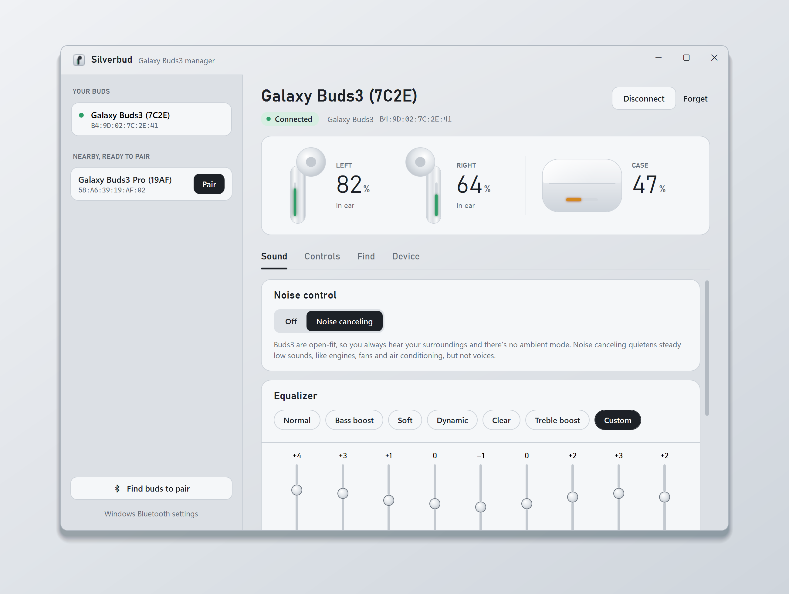
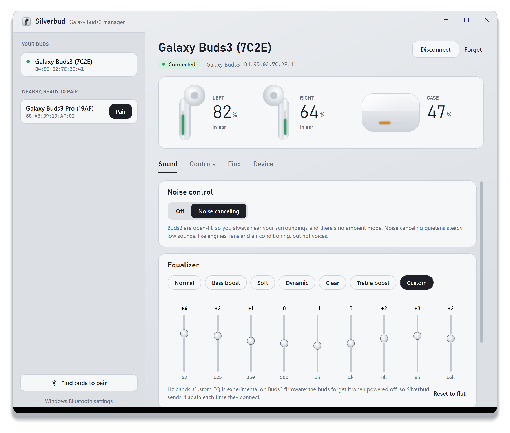
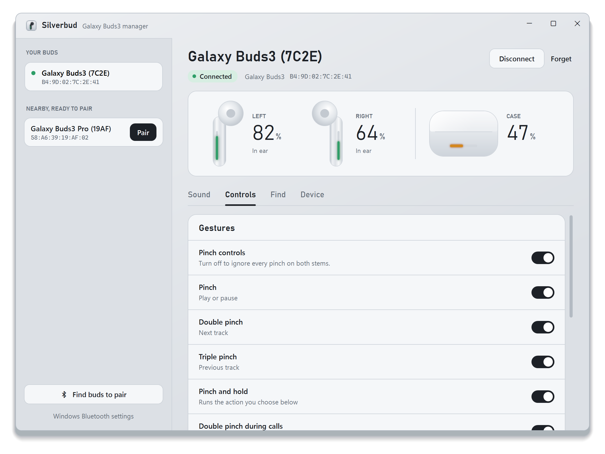
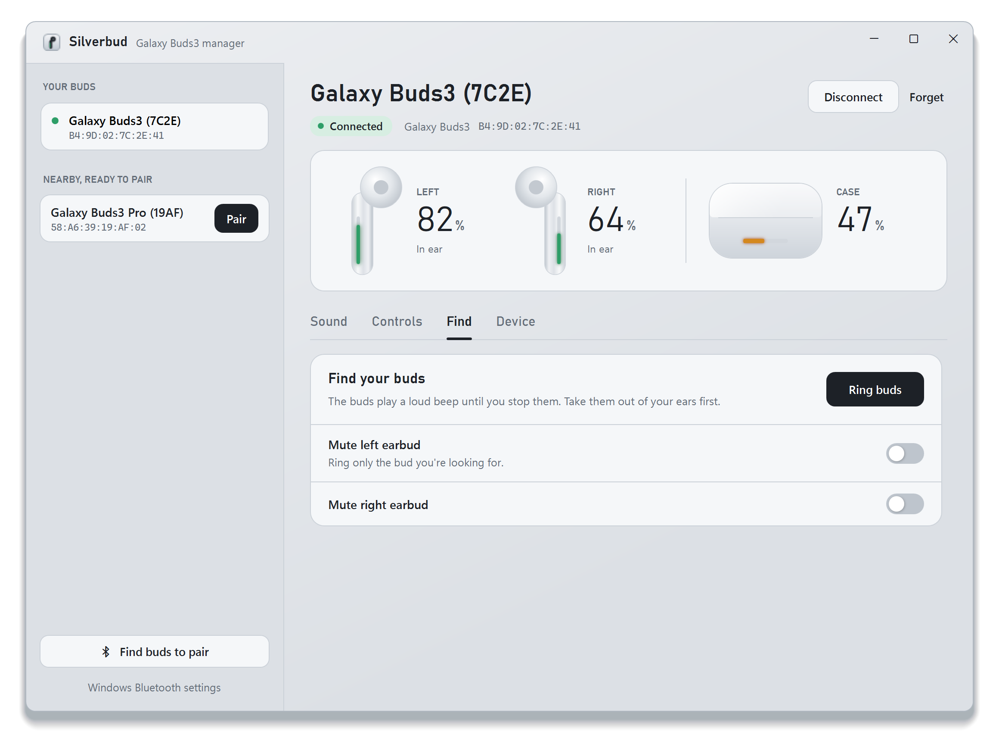
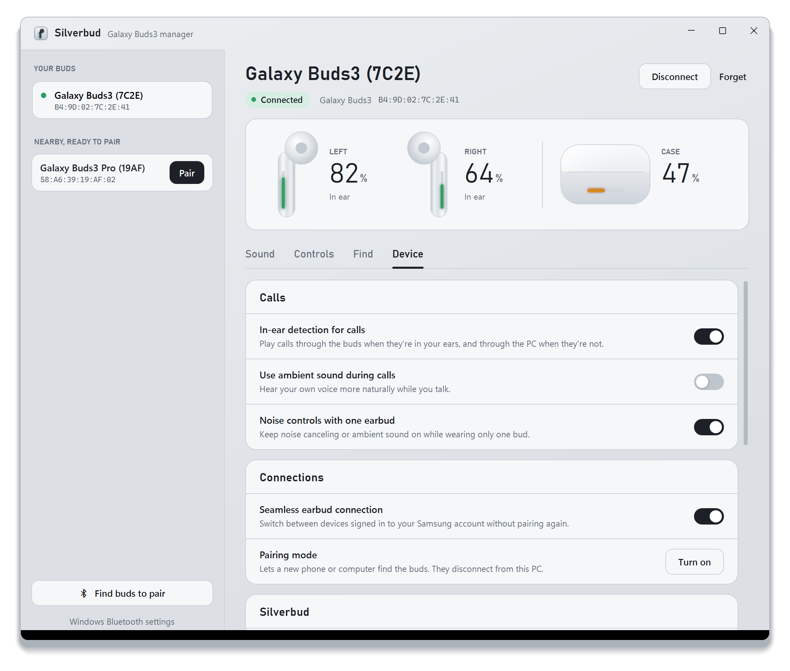
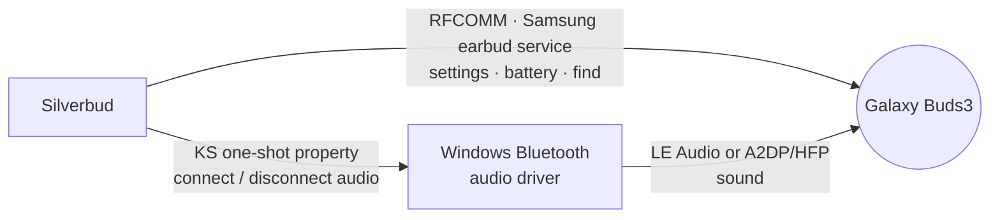

<p align="center">
  
</p>

<p align="center">
  <a href="https://github.com/Sliv3er/Silverbud/releases/latest"></a>
  <a href="https://github.com/Sliv3er/Silverbud/releases"></a>
  <a href="https://github.com/Sliv3er/Silverbud/actions/workflows/build.yml"></a>
  
  
  <a href="LICENSE"></a>
</p>

<p align="center">
  <b>Battery levels, noise canceling, EQ, pinch controls and Find My Buds for Samsung Galaxy Buds3, right from your Windows PC.</b><br>
  One portable <code>.exe</code>. No phone, no Samsung account, nothing to install.
</p>

<p align="center">
  <a href="https://github.com/Sliv3er/Silverbud/releases/latest/download/Silverbud.exe"><b>Download Silverbud.exe</b></a>
  &nbsp;·&nbsp;
  <a href="#features">Features</a>
  &nbsp;·&nbsp;
  <a href="#getting-started">Getting started</a>
  &nbsp;·&nbsp;
  <a href="docs/PROTOCOL.md">Protocol notes</a>
</p>

<p align="center">
  
</p>

## Why Silverbud

On Windows, your Galaxy Buds3 are just another headset. Windows can play audio through them, but it can't show each bud's battery, switch noise canceling, change the EQ or make a lost bud beep. All of that normally lives in the phone app.

Silverbud talks to the buds directly over Bluetooth, the same way the phone app does, and puts every setting in one window. Each earbud is drawn as a Buds3 stem whose blade light shows its charge.

## Features

| | |
|---|---|
| **Pair and connect** | Find buds in pairing mode and pair them. Connect and disconnect the audio with one click. It connects automatically when you take the buds out of the case, and turns Bluetooth on if it's off. Works with both **LE Audio** and classic Bluetooth. |
| **Battery** | Left, right and case levels, live. Shows whether each bud is in your ear, out, in the case or charging. Notifies you when a bud runs low. |
| **Noise control** | Off or noise canceling. On the Buds3 Pro, also ambient sound, with an ambient level, separate left/right levels and tone. The open-fit Buds3 have no ambient mode. |
| **Equalizer** | Normal, Bass boost, Soft, Dynamic, Clear, Treble boost, and a 9-band custom EQ (experimental). |
| **Listening** | Left/right balance and game mode (lower audio delay). |
| **Pinch controls** | Turn each gesture on or off, including call gestures. Pick the pinch-and-hold action per ear (noise controls, voice assistant, volume, Spotify). Double-tap the earbud edge for volume. |
| **Find my buds** | Ring the buds, and mute the left or right one to find the bud you lost. |
| **Calls and connections** | In-ear detection for calls, ambient sound during calls, noise controls with one earbud, seamless connection, pairing mode, factory reset. |
| **About** | Firmware version and hardware revision, read from the buds. |
| **Notification area** | Battery levels in the tray tooltip. Right-click to switch noise control or ring the buds. Optionally start with Windows and keep running when closed. |

## Screenshots

<table>
  <tr>
    <td width="50%"><p align="center"><b>Sound</b>: noise control and equalizer</p></td>
    <td width="50%"><p align="center"><b>Controls</b>: pinch gestures</p></td>
  </tr>
  <tr>
    <td width="50%"><p align="center"><b>Find</b>: ring a lost bud</p></td>
    <td width="50%"><p align="center"><b>Device</b>: calls, connections and app</p></td>
  </tr>
</table>

## Getting started

1. **Download** [`Silverbud.exe`](https://github.com/Sliv3er/Silverbud/releases/latest/download/Silverbud.exe) from the latest release and run it. It's self-contained, so there's nothing to install.
   > Windows SmartScreen may warn about an app from an unknown publisher, because the exe isn't code-signed. Select **More info → Run anyway**.
2. **Pair your buds.** Open the case with both buds inside, next to the PC, and select **Find buds to pair**. Then select **Pair** next to your buds.
   If they're already connected to your phone, turn on pairing mode from the phone first. Buds you've already paired in Windows Settings show up on their own.
3. **That's it.** Silverbud connects as soon as the buds are out of the case, and the battery levels appear. If Bluetooth is off, Silverbud turns it on for you.

Settings and a diagnostic log live in `%APPDATA%\Silverbud`.

## Compatibility

| | Status |
|---|---|
| **Galaxy Buds3** (firmware R530XXU0AYG3) on Windows 11, LE Audio pairing | Tested end to end |
| Galaxy Buds3 over classic Bluetooth (A2DP/HFP) | Supported (same control channel) |
| Galaxy Buds3 Pro | Untested. It shares the protocol, so most features should work. |
| Older Galaxy Buds models | Not supported (different status layout) |
| Windows 10 (19041+) / Windows 11, x64 | Supported |

Have a different model or firmware? A [log excerpt in an issue](https://github.com/Sliv3er/Silverbud/issues/new/choose) helps add support.

## How it works



- **Settings channel.** Silverbud opens an RFCOMM socket to the buds' Samsung service (`2e73a4ad-332d-41fc-90e2-16bef06523f2`). It exchanges small framed messages over it: `0xFD … 0xDD`, with a CRC-16/XMODEM checksum. The buds push a full status snapshot when the link opens, and push battery updates while it stays open.
- **Audio.** Windows plays the sound. Connect and Disconnect send the Bluetooth audio driver the same one-shot request as the Connect button in Windows Settings.
- **LE Audio.** Windows 11 can pair Buds3 as LE Audio devices. Silverbud watches both the classic and the LE connections, so it knows when the buds are in use either way.

The full message format, the Buds3 status layout and the quirks found on real hardware are documented in **[docs/PROTOCOL.md](docs/PROTOCOL.md)**.

## Troubleshooting

<details>
<summary><b>"The buds didn't answer"</b></summary>

Take the buds out of the case (or open it), keep them close to the PC, and select **Connect** again. If another app is connected to the buds' settings channel (for example Galaxy Buds Manager), close it first; only one app can hold it at a time.
</details>

<details>
<summary><b>"The buds aren't accepting a settings connection right now"</b></summary>

The buds are connected but won't offer their settings channel. This usually means the **Galaxy Wearable** app on your phone holds it, so close the app. Otherwise, put both buds in the case for 10 seconds and take them out. Silverbud keeps retrying in the background and connects as soon as the buds allow it.
</details>

<details>
<summary><b>Noise canceling switches back to Off</b></summary>

The buds refuse noise canceling (and ambient sound, on the Buds3 Pro) while you wear only one bud, unless **Noise controls with one earbud** is on. When that happens, Silverbud shows a notice in the Noise control card. Select **Allow with one bud** to turn the setting on and switch modes in one go. You can also change the setting in the **Device** tab.
</details>

<details>
<summary><b>My buds don't appear when searching</b></summary>

They're probably connected to your phone. Turn on pairing mode from the phone, or turn off the phone's Bluetooth, then select **Find buds to pair** again.
</details>

<details>
<summary><b>Where are the logs?</b></summary>

`%APPDATA%\Silverbud\silverbud.log`. It records every message exchanged with the buds. You can open the folder from **Device → Open log folder**.
</details>

## Building from source

Requirements: Windows 10/11 and the [.NET 10 SDK](https://dotnet.microsoft.com/download/dotnet/10.0).

```bash
git clone https://github.com/Sliv3er/Silverbud.git
cd Silverbud
dotnet run --project tests/Silverbud.Tests
dotnet publish src/Silverbud/Silverbud.csproj -c Release
```

The publish step produces one self-contained `Silverbud.exe` in `src/Silverbud/bin/Release/net10.0-windows10.0.19041.0/win-x64/publish/`.

Useful switches while developing:

| Switch | What it does |
|---|---|
| `--demo` | Opens the window filled with sample data, so you can work on the UI without buds |
| `--tray` | Starts in the notification area (used by **Start with Windows**) |
| `--probe-audio` | Logs every audio endpoint with its driver filter and container id, then exits |
| `--quit` | Closes a running Silverbud cleanly, releasing the buds' settings link (useful before replacing the exe) |

### Project layout

```
src/Silverbud/
  Core/            protocol framing, status parsing, RFCOMM link, pairing, audio connect
  ViewModels/      app state and every setting
  Controls/        battery gauges, setting rows, converters
  MainWindow.xaml  the UI      Theme.xaml  palette, type and control styles
tests/Silverbud.Tests/  protocol checks, including frames captured from real Buds3
docs/              protocol notes and images
```

## Contributing

Bug reports, captures from other models and pull requests are welcome. See [CONTRIBUTING.md](CONTRIBUTING.md).

If Silverbud is useful to you, **give it a star**. It helps other Galaxy Buds owners on Windows find it.

## Credits

The message ids and payload layouts of the earbud protocol were reverse-engineered by the open-source [GalaxyBudsClient](https://github.com/timschneeb/GalaxyBudsClient) project, which is an excellent multi-model client. Silverbud is an independent implementation focused on the Buds3. It adds its own findings from testing on real Buds3 hardware.

## Disclaimer

Silverbud is an unofficial, community project. It is not affiliated with, endorsed by or sponsored by Samsung. Samsung, Galaxy and Galaxy Buds are trademarks of Samsung Electronics Co., Ltd. Firmware features can change with updates; use **Factory reset** and other device actions at your own discretion.

## License

[MIT](LICENSE) © 2026 Sliv3er
